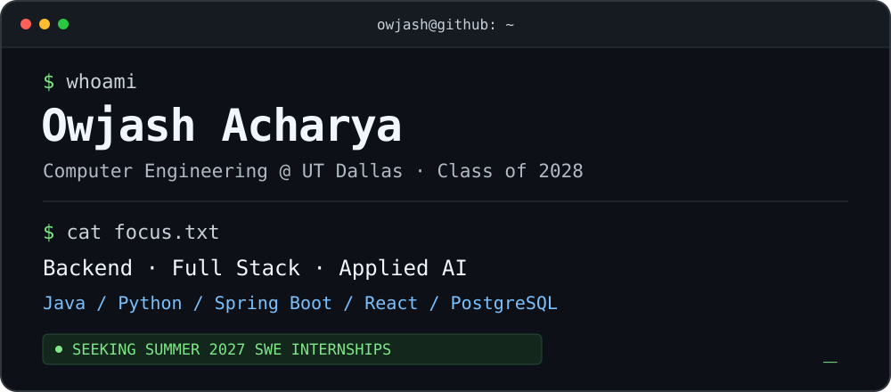

  

## 💫 About Me

- 🎓 Computer Engineering student at UT Dallas | Graduating May 2028.
- 💻 I build backend and full-stack applications with Java, Spring Boot, Python, and React.
- 🌱 Currently strengthening my backend fundamentals, data structures and algorithms, and AI application development skills.
- 🤝 Interested in collaborating on practical full-stack and AI-powered projects.
- 🎯 Seeking Summer 2027 software engineering internships.
- ⚡ Fun fact: I researched cobalt thin films during an NSF REU program before building AI-powered software.

## 🌐 Connect

 

## 🚀 Featured Projects

### [Stockroom — AI Inventory Manager](https://github.com/Owjash/Stockroom)

An inventory platform that combines stock management with questions answered from live business data and uploaded documents.

- Product and supplier management, low-stock alerts, and transactional sales and stock receipts.
- Ollama integration through Spring AI, using read-only Java tools to query inventory and sales records.
- PDF retrieval-augmented generation (RAG) with pgvector search and document/page citations.
- 27 automated tests covering APIs, transaction rollback, concurrent stock updates, PDF processing, and citation guards.

**Built with:** Java · Spring Boot · Spring AI · React · PostgreSQL · pgvector · Ollama

### [Vroom AI — HackUTD 2026](https://github.com/Owjash/Vroom-AI)

A four-person hackathon project connecting AI call events to a real-time dashboard.

**My contributions:** Integrated Retell AI webhooks with HMAC signature verification, connected Django to SpacetimeDB through HTTP reducers to synchronize call-session data, and built a React launch animation.

**Built with:** Python · Django · React · SpacetimeDB · Retell AI

### [Campus Study Group Finder](https://github.com/Owjash/Campus-Study-Group-Finder)

A full-stack application for creating and joining campus study sessions. Includes registration and login, session search, joined-session filtering, join/leave controls, and REST APIs with Pydantic validation.

**Built with:** React · Python · FastAPI · SQLite

## 💻 Tech Stack

**Languages & Web**

      

**Frameworks**

   

**Databases**

 

**Tools**

   

**Also used:** Spring AI, Ollama, pgvector, SpacetimeDB, SQL, and REST APIs.

## 📊 GitHub Stats

 
 

<!-- Badges and stats generated with GPRM: https://gprm.itsvg.in -->
