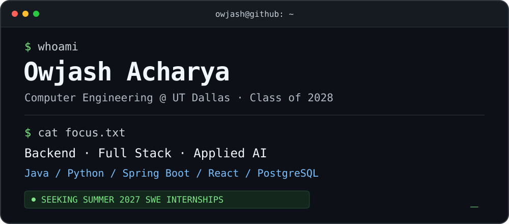

  

  <a href="https://www.linkedin.com/in/owjash-acharya">LinkedIn</a>
  &nbsp;·&nbsp;
  <a href="https://github.com/Owjash?tab=repositories">Repositories</a>

I'm a Computer Engineering student at **The University of Texas at Dallas**, graduating in **May 2028**, and based in Irving, Texas. I build applications with Java, Python, and React, with a focus on backend APIs, databases, and practical AI integrations.

**Seeking Summer 2027 software engineering internships.**

## Featured Projects

### [Stockroom — AI Inventory Manager](https://github.com/Owjash/Stockroom)

An inventory platform that combines stock management with questions answered from live business data and uploaded documents.

- Product and supplier management, low-stock alerts, and transactional sales and stock receipts.
- Ollama integration through Spring AI, using read-only Java tools to query inventory and sales records.
- PDF retrieval-augmented generation (RAG) with pgvector search and document/page citations.
- 27 automated tests covering APIs, transaction rollback, concurrent stock updates, PDF processing, and citation guards.

**Built with:** Java · Spring Boot · Spring AI · React · PostgreSQL · pgvector · Ollama

### [Vroom AI — HackUTD 2026](https://github.com/Owjash/Vroom-AI)

A four-person hackathon project connecting AI call events to a real-time dashboard.

**My contributions:** Integrated Retell AI webhooks with HMAC signature verification, connected Django to SpacetimeDB through HTTP reducers to synchronize call-session data, and built a React launch animation.

**Built with:** Python · Django · React · SpacetimeDB · Retell AI

### [Campus Study Group Finder](https://github.com/Owjash/Campus-Study-Group-Finder)

A full-stack application for creating and joining campus study sessions. Includes registration and login, session search, joined-session filtering, join/leave controls, and REST APIs with Pydantic validation.

**Built with:** React · Python · FastAPI · SQLite

## Technologies I've Used

| Area | Technologies |
| --- | --- |
| Languages | Java, Python, C++, JavaScript, SQL |
| Backend | Spring Boot, Spring AI, FastAPI, Django, REST APIs |
| Frontend | React, HTML, CSS |
| Data | PostgreSQL, pgvector, SQLite, SpacetimeDB |
| Tools | Git, GitHub, Docker, Maven |

## Beyond Software

As an **NSF REU undergraduate researcher**, I studied cobalt thin-film oxidation using X-ray Photoelectron Spectroscopy, documented experimental results, and presented my findings at the program symposium.
